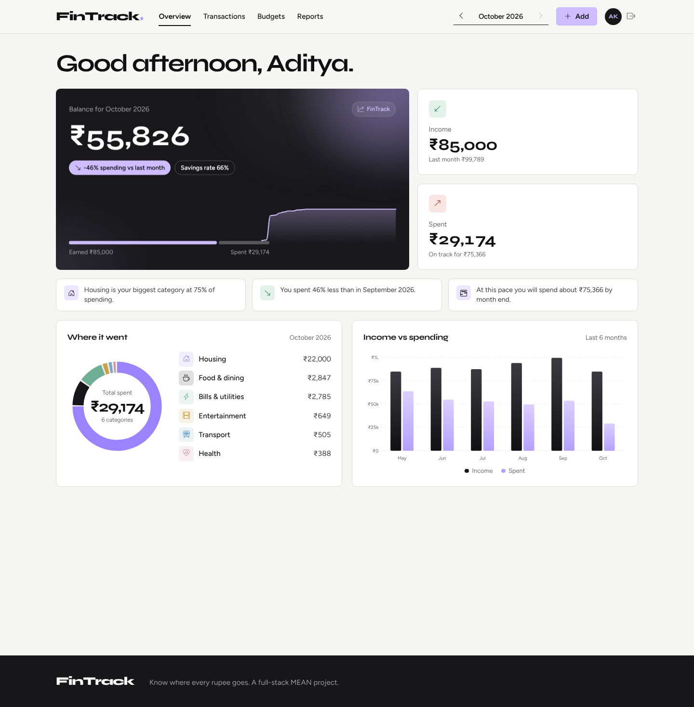
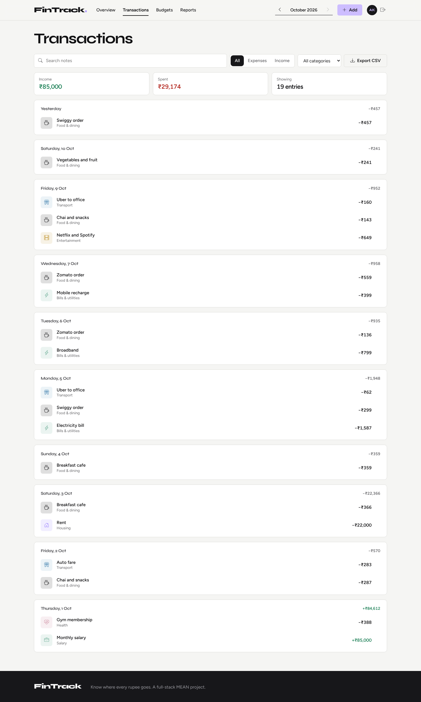
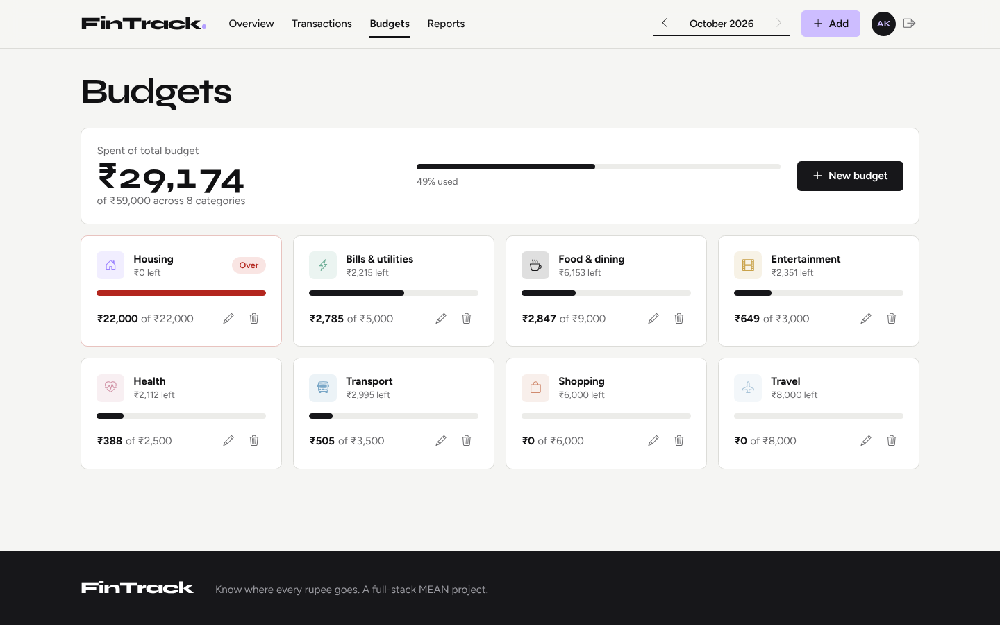
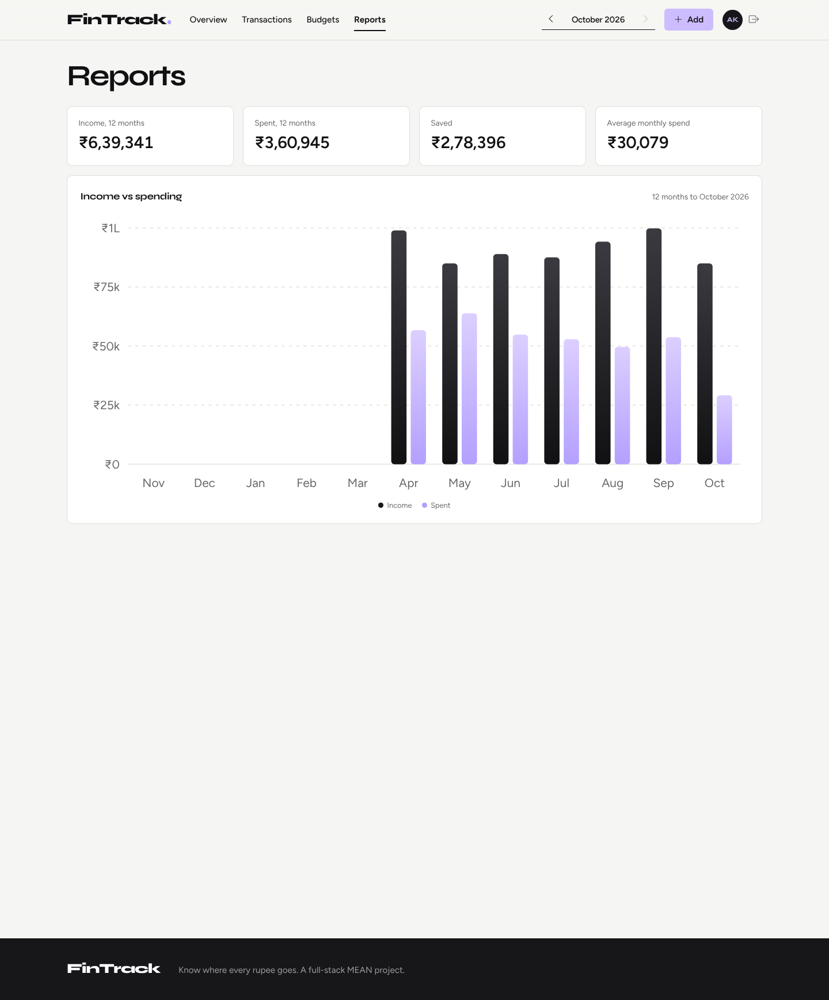
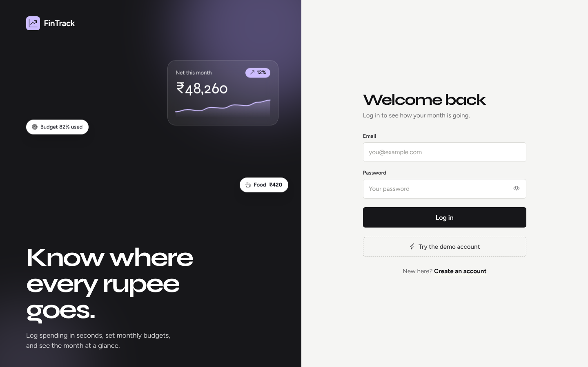
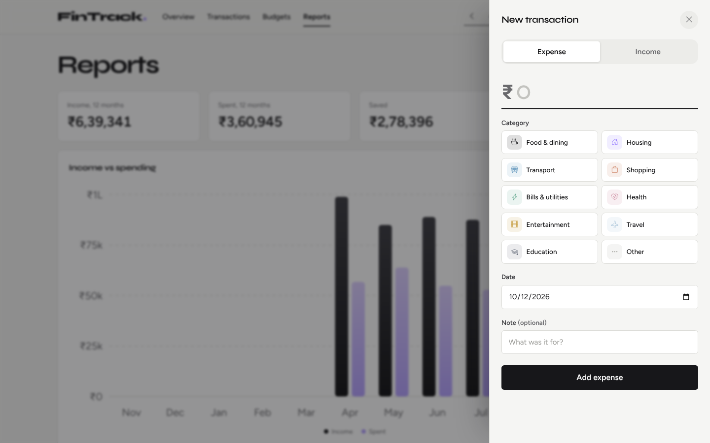

# FinTrack

A personal finance tracker built with the MEAN stack. Log income and expenses, set monthly budgets, and see where your money goes.



## Features

- Add, edit and delete income and expense transactions with category, date and note
- Monthly budgets per category, with alerts at 80% and when over
- Dashboard: balance, income, spending, savings rate, spending by category, 6-month income vs spending
- Search and filter by type, category and text, with paging
- Reports: 12-month trend, month-by-month table, category breakdown
- Export any month to CSV
- JWT login and register, passwords hashed with bcrypt
- Stats computed with MongoDB aggregation
- Animated UI built with the Motion library, works on phones

## Screenshots

| Transactions | Budgets |
| --- | --- |
|  |  |







## Tech

Angular 22 (standalone, signals), Motion, Syne + Figtree type, Node.js, Express 5, MongoDB with Mongoose, JWT.

## How to run

You need Node.js 20+.

1. Install everything

   ```
   npm run install-all
   ```

2. Create the server config

   ```
   copy server\.env.example server\.env
   ```

   (macOS/Linux: `cp server/.env.example server/.env`). Leave `MONGO_URI` empty to use a built-in temporary database that is filled with demo data on every start. To keep your data, put your MongoDB connection string there.

3. Start the API and the app together

   ```
   npm run dev
   ```

4. Open the app on port 4200 and log in with the demo account:

   - Email: `demo@fintrack.dev`
   - Password: `Demo@123`

Other commands: `npm run build` builds the client, `npm start` serves the build from the API, `npm run seed` loads demo data into your own MongoDB.

## Structure

```
server/src
  models/      User, Transaction, Budget
  routes/      auth, transactions, budgets, stats
  seed/        demo data
client/src/app
  core/        services, guards, interceptor, models
  layout/      shell and add/edit sheet
  pages/       auth, dashboard, transactions, budgets, reports
  shared/      donut, bars, sparkline, count-up, reveal
```
